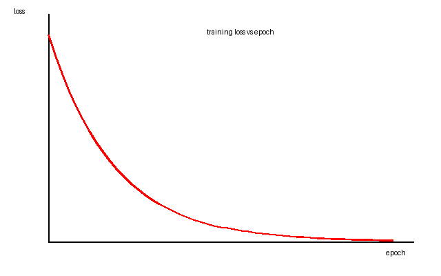

## 第 2 章 / Chapter 2　第一章 概述

### 章节概述 / Chapter Overview

<!-- COURSENOTES:SECTION C02-OVERVIEW START -->
<!-- COURSENOTES:TODO --> 用 3–6 句写出本章概述：本章解决什么问题、与前后章的关系、学完后应具备的能力。
<!-- COURSENOTES:SECTION C02-OVERVIEW END -->

- 原始课件 / Source files: fixture_outline.docx
- 知识点数量 / Knowledge points: 5
- 公式候选 / Formula candidates: 1
- 图表待解读 / Figures needing vision: 1

### 本章学习目标 / Learning Objectives

<!-- COURSENOTES:SECTION C02-OBJECTIVES START -->
<!-- COURSENOTES:TODO --> 依据本章知识点写出 3–6 条可检验的学习目标（能推导/能实现/能对比/能判断）。
<!-- COURSENOTES:SECTION C02-OBJECTIVES END -->

### 知识结构 / Knowledge Outline

- 第一章 概述
  - OSI 参考模型
  - 关键对比
  - 公式示例

### 详细知识点 / Detailed Knowledge Points

<!-- COURSENOTES:POINT K008 START -->
### K008 · 1. 计算机网络（Computer Network）将地理位置不同的计算机互联，实现资源共享与信息传递。
**类型 / Kind**: 模型/架构　**来源 / Source**: fixture_outline.docx · paragraph 2

**术语定义 / Definition**

- 计算机网络（Computer Network）

#### 中文讲解 / Chinese Explanation

**材料原文依据 / Material evidence**

```text
计算机网络（Computer Network）将地理位置不同的计算机互联，实现资源共享与信息传递。
```

<!-- COURSENOTES:TODO --> 在此写出中文详细讲解：概念是什么 → 为什么需要 → 如何工作 → 数学/技术原理 → 示例 → 应用 → 常见误区。不得压缩为要点罗列。

#### 英文讲解 / English Explanation

<!-- COURSENOTES:TODO --> Write the full English explanation here with the same technical content, definitions and conclusions as the Chinese section. It must not be a translation of the headings only.

#### 易错点 / Common Misconceptions

<!-- COURSENOTES:TODO --> 列出 1–3 条本知识点的常见误解与区分要点。

**来源 / References**

- [课件内容] fixture_outline.docx · paragraph 2

<!-- COURSENOTES:POINT K008 END -->

<!-- COURSENOTES:POINT K009 START -->
### K009 · 2. OSI 七层模型：物理层（Physical Layer）、数据链路层（Data Link Layer, DLL）、网…
**类型 / Kind**: 模型/架构　**来源 / Source**: fixture_outline.docx · paragraph 4 · OSI 参考模型

**术语定义 / Definition**

- 物理层（Physical Layer）
- 数据链路层（Data Link Layer, DLL）
- 网络层（Network Layer）
- 传输层（Transport Layer）

#### 中文讲解 / Chinese Explanation

**材料原文依据 / Material evidence**

```text
OSI 七层模型：物理层（Physical Layer）、数据链路层（Data Link Layer, DLL）、网络层（Network Layer）、传输层（Transport Layer）、会话层、表示层、应用层。
```

<!-- COURSENOTES:TODO --> 在此写出中文详细讲解：概念是什么 → 为什么需要 → 如何工作 → 数学/技术原理 → 示例 → 应用 → 常见误区。不得压缩为要点罗列。

#### 英文讲解 / English Explanation

<!-- COURSENOTES:TODO --> Write the full English explanation here with the same technical content, definitions and conclusions as the Chinese section. It must not be a translation of the headings only.

#### 易错点 / Common Misconceptions

<!-- COURSENOTES:TODO --> 列出 1–3 条本知识点的常见误解与区分要点。

**来源 / References**

- [课件内容] fixture_outline.docx · paragraph 4 · OSI 参考模型

<!-- COURSENOTES:POINT K009 END -->

<!-- COURSENOTES:POINT K010 START -->
### K010 · 3. 网络层 PDU 称为分组（packet），传输层 PDU 称为报文段（segment）。
**类型 / Kind**: 定义　**来源 / Source**: fixture_outline.docx · paragraph 5 · OSI 参考模型

**术语定义 / Definition**

- <!-- COURSENOTES:TODO --> 从材料中未能自动识别术语对，请依据来源文本补充术语、英文全称与缩写。

#### 中文讲解 / Chinese Explanation

**材料原文依据 / Material evidence**

```text
网络层 PDU 称为分组（packet），传输层 PDU 称为报文段（segment）。
```

<!-- COURSENOTES:TODO --> 在此写出中文详细讲解：概念是什么 → 为什么需要 → 如何工作 → 数学/技术原理 → 示例 → 应用 → 常见误区。不得压缩为要点罗列。

#### 英文讲解 / English Explanation

<!-- COURSENOTES:TODO --> Write the full English explanation here with the same technical content, definitions and conclusions as the Chinese section. It must not be a translation of the headings only.

#### 易错点 / Common Misconceptions

<!-- COURSENOTES:TODO --> 列出 1–3 条本知识点的常见误解与区分要点。

**来源 / References**

- [课件内容] fixture_outline.docx · paragraph 5 · OSI 参考模型

<!-- COURSENOTES:POINT K010 END -->

<!-- COURSENOTES:POINT K011 START -->
### K011 · 4. 表格：对比项 / 面向连接 vs 无连接
**类型 / Kind**: 表格　**来源 / Source**: fixture_outline.docx · table 1 · 关键对比

**术语定义 / Definition**

- <!-- COURSENOTES:TODO --> 从材料中未能自动识别术语对，请依据来源文本补充术语、英文全称与缩写。

#### 中文讲解 / Chinese Explanation

**材料原文依据 / Material evidence**

```text
对比项 | 面向连接 vs 无连接
连接建立 | 需要握手 / 无需握手
典型协议 | TCP / UDP
```

<!-- COURSENOTES:TODO --> 在此写出中文详细讲解：概念是什么 → 为什么需要 → 如何工作 → 数学/技术原理 → 示例 → 应用 → 常见误区。不得压缩为要点罗列。

#### 英文讲解 / English Explanation

<!-- COURSENOTES:TODO --> Write the full English explanation here with the same technical content, definitions and conclusions as the Chinese section. It must not be a translation of the headings only.

#### 易错点 / Common Misconceptions

<!-- COURSENOTES:TODO --> 列出 1–3 条本知识点的常见误解与区分要点。

**来源 / References**

- [课件内容] fixture_outline.docx · table 1 · 关键对比

<!-- COURSENOTES:POINT K011 END -->

<!-- COURSENOTES:POINT K012 START -->
### K012 · 5. 信道容量遵循香农公式 C = B * log2(1 + S/N)，其中 B 为带宽，S/N 为信噪比。
**类型 / Kind**: 公式　**来源 / Source**: fixture_outline.docx · paragraph 8 · 公式示例

**术语定义 / Definition**

- <!-- COURSENOTES:TODO --> 从材料中未能自动识别术语对，请依据来源文本补充术语、英文全称与缩写。

#### 中文讲解 / Chinese Explanation

**材料原文依据 / Material evidence**

```text
信道容量遵循香农公式 C = B * log2(1 + S/N)，其中 B 为带宽，S/N 为信噪比。
```

<!-- COURSENOTES:TODO --> 在此写出中文详细讲解：概念是什么 → 为什么需要 → 如何工作 → 数学/技术原理 → 示例 → 应用 → 常见误区。不得压缩为要点罗列。

#### 英文讲解 / English Explanation

<!-- COURSENOTES:TODO --> Write the full English explanation here with the same technical content, definitions and conclusions as the Chinese section. It must not be a translation of the headings only.

#### 数学原理 / Mathematical Principles

$$
\text{（替换为材料中的公式 / replace with the formula from the material）}
$$

<!-- COURSENOTES:TODO --> 逐项说明：① 每个变量与符号的含义、量纲与取值范围；② 公式成立的条件与前提；③ 必要的推导步骤；④ 直观意义；⑤ 一个完整的数值计算示例。

#### 易错点 / Common Misconceptions

<!-- COURSENOTES:TODO --> 列出 1–3 条本知识点的常见误解与区分要点。

**来源 / References**

- [课件内容] fixture_outline.docx · paragraph 8 · 公式示例

<!-- COURSENOTES:POINT K012 END -->

### 公式清单 / Formula Checklist

- `信道容量遵循香农公式 C = B * log2(1 + S/N)，其中 B 为带宽，S/N 为信噪比。` — fixture_outline.docx · paragraph 8（识别依据：contains mathematical symbols or an equation pattern）

### 公式清单 / Formula Checklist

<!-- COURSENOTES:SECTION C02-FORMULAS START -->
<!-- COURSENOTES:TODO --> 为以上每个公式补全 LaTeX 表示、变量定义、成立条件、推导与数值示例。
<!-- COURSENOTES:SECTION C02-FORMULAS END -->

### 图表解读 / Figures to Interpret



> 来源 / Source: fixture_outline.docx · paragraph 9　优先级 / priority: normal
> 视觉任务 / Vision task: V003 — 图表 / figure
> 任务 / Task: Explain the knowledge the figure encodes (its structure, flow, axes or steps) rather than relabelling the text inside it.

**尚未解读 / not interpreted yet**：本插件的模型通道不能直接接收图片输入，因此图片内容必须由具备视觉能力的 Agent（例如先 `read_image` 再写回 `vision-results.json`）或人工补全。

**Not interpreted.** The model channel available to this plugin cannot receive image input; the figure must be read by an agent with a vision tool (write the result into `.coursenotes/vision-results.json`) or by a human.

### 图表解读 / Figures to Interpret

<!-- COURSENOTES:SECTION C02-FIGURES START -->
<!-- COURSENOTES:TODO --> 对尚未解读的图表，请依据视觉解读结果写出知识层面的解释；无法确认的细节必须标注。
<!-- COURSENOTES:SECTION C02-FIGURES END -->

### 本章总结 / Chapter Summary

<!-- COURSENOTES:SECTION C02-SUMMARY START -->
<!-- COURSENOTES:TODO --> 用要点+一句话结论总结本章，并指出与后续章节的衔接。
<!-- COURSENOTES:SECTION C02-SUMMARY END -->

### 术语表 / Glossary

| 中文术语 | English Full Name | Abbreviation | 简要解释 |
| --- | --- | --- | --- |
| 计算机网络 | Computer Network | — |  |
| 物理层 | Physical Layer | — |  |
| 数据链路层 | Data Link Layer | DLL |  |
| 网络层 | Network Layer | — |  |
| 传输层 | Transport Layer | — |  |

### 重点与难点 / Key Points and Difficulties

<!-- COURSENOTES:SECTION C02-DIFFICULTIES START -->
<!-- COURSENOTES:TODO --> 标注本章重点与难点，并说明难在哪里（概念抽象/推导繁琐/易混淆/需要先修知识）。
<!-- COURSENOTES:SECTION C02-DIFFICULTIES END -->

### 自测题 / Self-Assessment Questions

<!-- COURSENOTES:SECTION C02-EXERCISES START -->
<!-- COURSENOTES:TODO --> 生成 3–5 道可自测的问题（含答案要点），覆盖本章核心知识点。
<!-- COURSENOTES:SECTION C02-EXERCISES END -->

### 参考资料 / References

- （本次运行未获取到可引用的外部来源。/ No external reference was retrieved in this run.)

